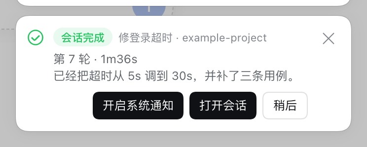

# DSH 插件合集

给 [DeepSeek Harness](https://www.npmjs.com/package/@deepseek-ai/dsh) Web 用的插件：**让长任务不用盯屏幕，让并行任务各占一个工作区。**

| 包名 | 作用 | 依赖 | 截图 |
|---|---|---|---|
| [`dsh-notify`](<packages/dsh-notify/README.md>) | 会话跑完、等你授权、等你回答时喊你 —— 页内提示条 / 系统通知 / 提示音 / 标签页标题四条渠道，可转 webhook 推到手机 | DSH Web |  |
| [`dsh-worktree`](<packages/dsh-worktree/README.md>) | 在侧边栏开 Git worktree 并在里面起新会话，并行任务互不打架；也能让模型自己开 | DSH Web、Git、`dsh-tools` |  |
