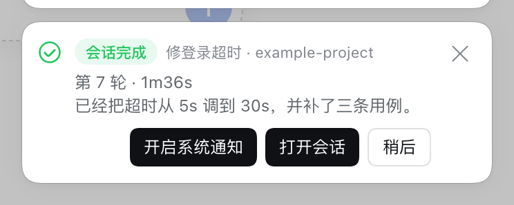
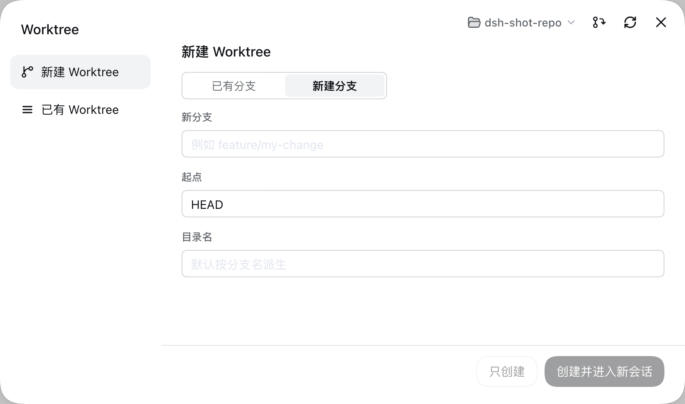

# DSH 插件合集

给 [DeepSeek Harness](https://www.npmjs.com/package/@deepseek-ai/dsh) Web 用的插件：**长任务不用盯屏幕，并行任务各有工作区。** 点击插件名查看安装和使用说明。

| 包名 | 作用 | 需要 | 截图 |
|---|---|---|---|
| [`@zhanghanxuan/dsh-notify`](<packages/dsh-notify/README.md>) | 任务完成、等待审批或回答时提醒你 | DSH Web |  |
| [`@zhanghanxuan/dsh-worktree`](<packages/dsh-worktree/README.md>) | 为并行任务创建独立 Git 工作区，并在其中打开新会话 | DSH Web、Git |  |
