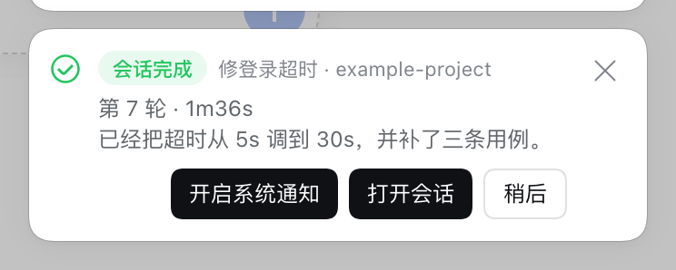
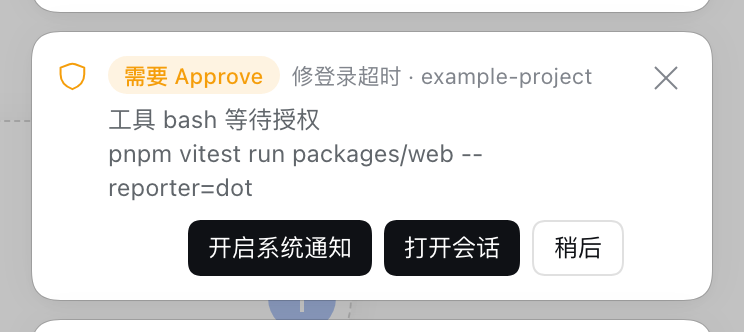
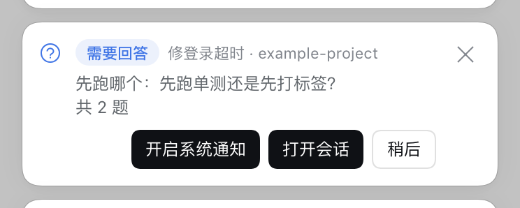
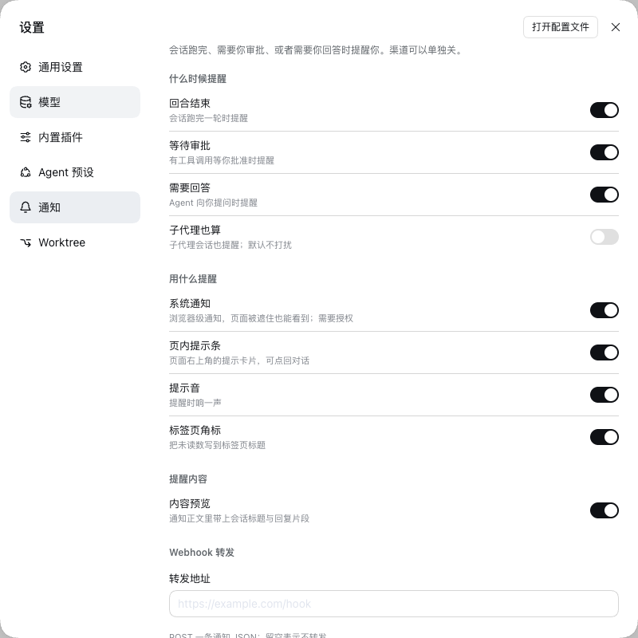
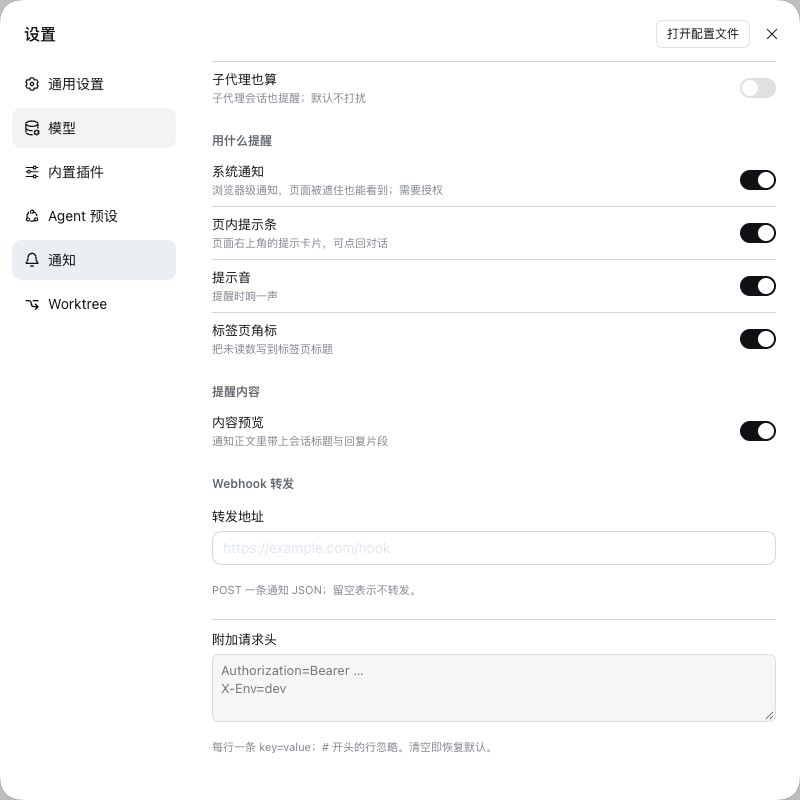

# dsh-notify

**任务完成、等待审批、需要回答时提醒你 —— 长任务不用一直盯着屏幕。**



## 安装

需要已安装的 DSH Web。在终端运行：

```bash
dsh plugin --profile web add @zhanghanxuan/dsh-notify
```

安装后重启 DSH，再刷新页面。使用其他 profile 时，将命令中的 `web` 换成对应名称。

## 使用

安装后自动提醒，无需在每个会话里单独开启：

- **任务完成**：会话跑完一轮，提醒你回来查看回复。
- **等待审批**：有工具调用需要你批准时提醒。
- **需要回答**：AI 向你提问、等待你补充信息时提醒。

点击页面右上角的通知卡片，即可回到对应会话。

| 等待审批 | 需要回答 |
|---|---|
|  |  |

### 选择提醒方式

打开 DSH **设置 → 通知**（铃铛图标），选择提醒事件和渠道；开关修改后自动保存。



按需开启或关闭：

| 提醒方式 | 用途 |
|---|---|
| 页内提示条 | 在页面右上角显示通知卡片，点击回到会话 |
| 系统通知 | 切到其他标签页或应用时，也能收到提醒 |
| 提示音 | 页面被遮住时，通过声音提醒 |
| 标签页角标 | 在标签页标题中显示未读数量 |

默认开启以上四种方式。首次使用系统通知时，请允许浏览器发送通知；如果收不到，请检查浏览器的站点通知权限，以及系统通知设置和勿扰模式。提示音可能需要先与页面交互一次。

### 调整提醒内容

在 **设置 → 通知** 中，还可以选择提醒哪些事件、是否包含子代理会话，以及是否显示内容预览。子代理提醒默认关闭，不想在通知里展示回复片段时，可关闭**内容预览**。

向下滚动到 **Webhook 转发**，可填写接收通知的**转发地址**，把提醒转到手机或聊天工具；附加请求头按 `名称=值` 每行一条填写，文本编辑后移开焦点保存。请只使用可信的接收地址。

<details>
<summary>查看内容预览与 Webhook 设置</summary>



</details>

## 卸载

```bash
dsh plugin --profile web remove @zhanghanxuan/dsh-notify
```

卸载后重启 DSH 并刷新页面。
