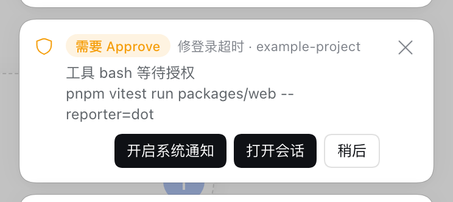
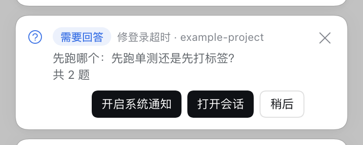
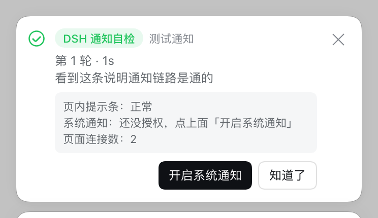

# dsh-notify

**会话跑完、等你授权、等你回答 —— 人不用盯着屏幕。**


## 安装

需要 Node.js 24+、pnpm 11.25.0 和已安装的 DSH Web。以下命令从仓库根目录运行：

```bash
git clone https://github.com/stekovinbranturry/dsh-plugins.git
cd dsh-plugins
pnpm install --frozen-lockfile
pnpm --filter @zhanghanxuan/dsh-notify run build
pnpm --filter @zhanghanxuan/dsh-notify run install:profile
```

这是本地 link 安装，请保留仓库目录。**安装后必须重启 DSH，并刷新页面。**
浏览器系统通知需要在浏览器里点一次「允许」。
卸载：`pnpm --filter @zhanghanxuan/dsh-notify run uninstall:profile`。

## 它解决什么

长任务一跑几分钟，切走干别的就不知道什么时候轮到自己了。这个插件把三种「轮到你了」接出来：

- **会话完成** —— 这一轮跑完了，回复已经在等着
- **需要 Approve** —— 模型要动工具，等你点头才继续
- **需要回答** —— 模型有问题问你，整个会话卡在那里

四种送达渠道，各自开关：

| 渠道 | 什么时候有用 |
|---|---|
| **页内提示条** | 页面就在眼前 —— 右上角弹卡片，点一下直接跳回那个会话 |
| **浏览器系统通知** | 切到了别的软件、别的标签 —— 走操作系统通知穿透出去 |
| **提示音** | 页面被遮住，但你还想听见 |
| **标签页标题** | 瞟一眼标签栏就知道积了几条未读 |

外加 **webhook**：每条通知同时 POST 一份 JSON 出去，可以转到手机、IM 机器人。
headless / SDK 这种没有浏览器的组合，webhook 照样能用。

## 卡片

| 需要 Approve | 需要回答 |
|---|---|
|  |  |

卡片上带会话名、工作区、回复预览或待批的命令；点一下回到对应会话。

## 自检

「为什么我切走了却没收到通知？」—— 在 DSH 页面打开浏览器控制台，跑一句：

```js
window.__dshNotifyTest()
```

它把三种卡片摆一遍，并真实走一次宿主 → 页面 的链路，最后把**页内提示条、系统通知授权、
webhook** 三件事的体检结论直接写在卡片上。



## 配置

没有设置面板 —— 改配置要编辑 DSH profile 的 `cordis.patch.yml`（`~/.dsh/profiles/<profile>/cordis.patch.yml`），在 `dsh-notify` 那条 entry 上加一段 `config:`：

```yaml
- id: dsh-notify
  name: '@zhanghanxuan/dsh-notify'
  config:
    sound: false
```

改完重启 DSH 生效。默认值按「装了就有用」给，四条渠道全开。

| 项 | 默认 | 说明 |
|---|---|---|
| `notifyOnTurnEnd` | `true` | 会话跑完时通知 |
| `notifyOnApproval` | `true` | 需要 Approve 时通知 |
| `notifyOnQuestion` | `true` | 需要回答时通知 |
| `includeSubagents` | `false` | 子代理会话也通知；默认不打扰 |
| `ack` | `true` | 页内提示条 |
| `browser` | `true` | 浏览器系统通知（需授权） |
| `sound` | `true` | 提示音 |
| `title` | `true` | 未读条数写到标签页标题 |
| `showPreview` | `true` | 通知正文带会话 / 回复预览 |
| `webhookUrl` | `''` | 外部 webhook：POST 通知 JSON |
| `webhookHeaders` | `{}` | webhook 的附加请求头 |

## 本地开发

```bash
pnpm --filter @zhanghanxuan/dsh-notify run build
pnpm --filter @zhanghanxuan/dsh-notify run dev:client
pnpm --filter @zhanghanxuan/dsh-notify run dev:host
pnpm --filter @zhanghanxuan/dsh-notify run test
```

客户端改动构建后刷新页面生效；宿主改动要重启 DSH 再刷新。
