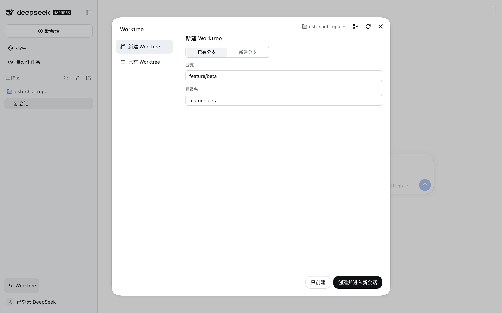
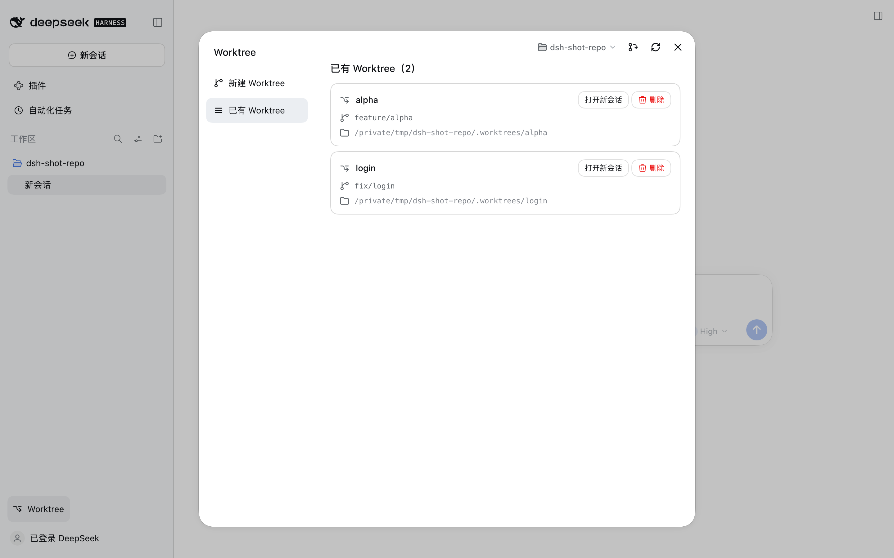
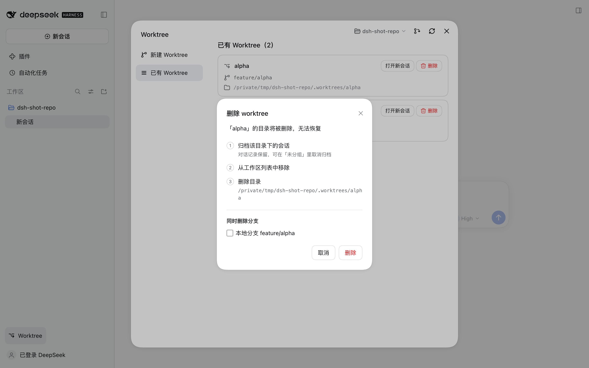

# dsh-worktree

**一个任务一个工作区 —— 开 Git worktree、在里面起新会话，侧边栏点一下。**



## 安装

需要 Node.js 24+、pnpm 11.25.0、Git 和已安装的 DSH Web。以下命令从仓库根目录运行：

```bash
git clone https://github.com/stekovinbranturry/dsh-plugins.git
cd dsh-plugins
pnpm install --frozen-lockfile
pnpm --filter dsh-worktree run build
pnpm --filter dsh-worktree run install:profile
```

这是本地 link 安装，请保留仓库目录。**安装后必须重启 DSH，并刷新页面。**
卸载：`pnpm --filter dsh-worktree run uninstall:profile`。

## 它解决什么

多个任务并行时，在同一个工作目录里切分支是最容易出事的地方：一个任务改到一半，另一个任务要你切走，
未提交的改动就得先 stash。Git worktree 是标准解法 —— 每个任务一个独立目录、一条独立分支 ——
但它们散在文件系统里，开一个要 `git worktree add` + 开终端 + 起会话。

这个插件把它收进侧边栏底部的一行「Worktree」：


- **开 worktree** —— 选已有分支或新建分支，目录落在仓库的 `.worktrees/` 下
- **起新会话** —— 新会话的 cwd 直接冻在那个 worktree 里，模型一开始就站在正确的位置
- **删 worktree** —— 归档它下面的会话 → 删目录 → 可选删分支
- **交给模型** —— 四个工具：`worktree_list` / `worktree_create` / `worktree_open` / `worktree_remove`

删的时候会拦下真正危险的情况：有未提交改动、被 `git worktree lock` 锁住、分支没合并、
以及**正要删当前会话自己所在的目录**。写操作走 DSH 沙箱策略，只读会话或工作区外的目录提前拒绝，
不会撞到 git 才报错。

新开的 worktree 默认注册成一个独立项目，左侧栏按项目分组时嵌在仓库底下。

| 已有 worktree | 删除确认 |
|---|---|
|  |  |

## 配置

同样没有设置面板 —— 在 DSH profile 的 `cordis.patch.yml` 里给 `dsh-worktree` 那条 entry 加 `config:`，重启 DSH 生效。

| 项 | 默认 | 说明 |
|---|---|---|
| `worktreeRoot` | `.worktrees` | worktree 根目录，相对仓库根 |
| `titleTemplate` | `wt: {name}` | 工作区（项目）名模板：`{compact}` `{spaced}` `{name}` `{branch}` `{path}` `{repo}` |
| `sessionTitleTemplate` | `{spaced}` | 会话名模板；默认把连字符换成空格 |
| `handoffTemplate` | `''` | 交接消息模板：`{name}` `{branch}` `{path}` `{repo}` `{task}`；默认空 = 新会话一条消息都不发 |
| `registerProject` | `true` | 把 worktree 目录注册成独立项目（左侧栏按项目分组） |
| `writeExclude` | `true` | 把 worktree 根目录写进共享 `.git/info/exclude` |

## 本地开发

```bash
pnpm --filter dsh-worktree run build
pnpm --filter dsh-worktree run dev:client
pnpm --filter dsh-worktree run dev:host
pnpm --filter dsh-worktree run test
```

客户端改动构建后刷新页面生效；宿主改动要重启 DSH 再刷新。
