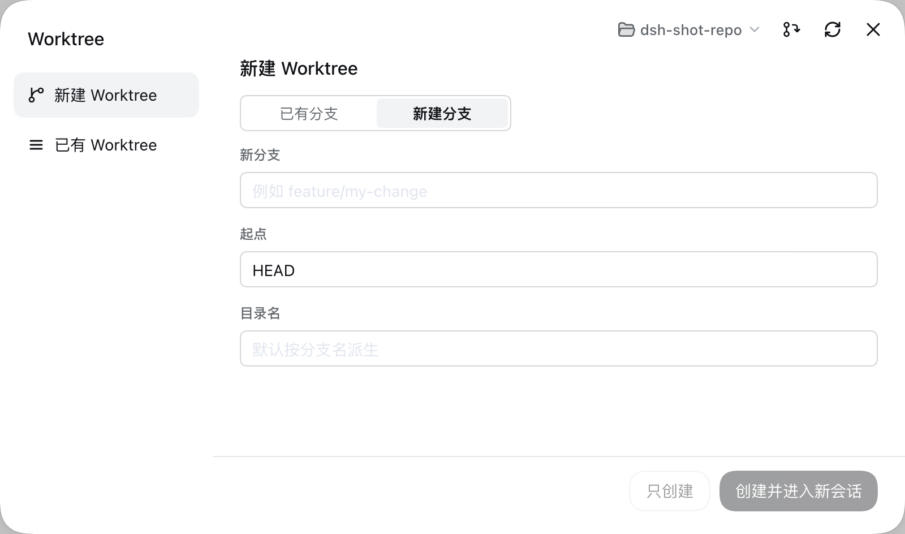
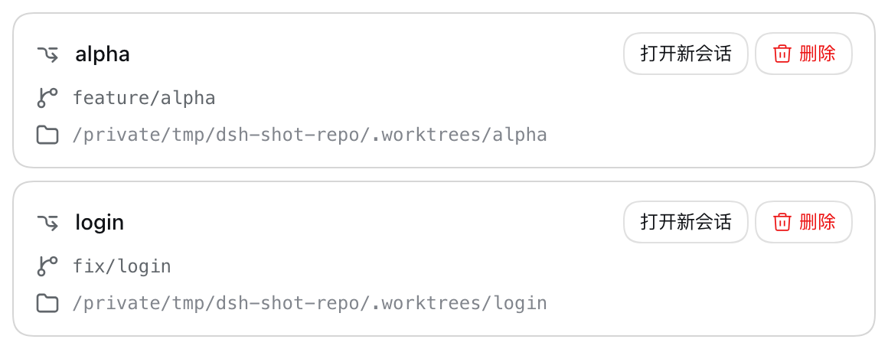
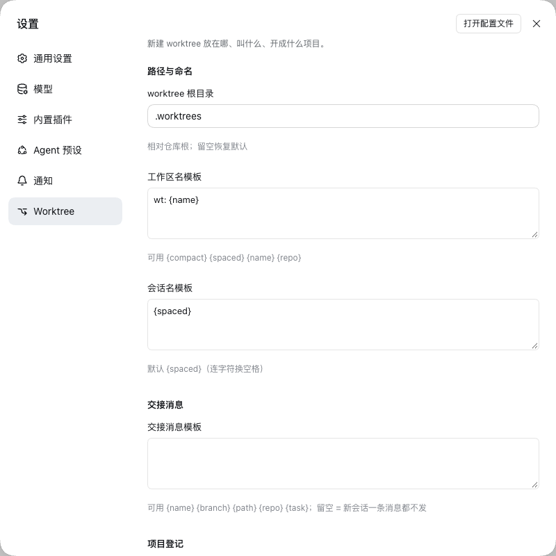
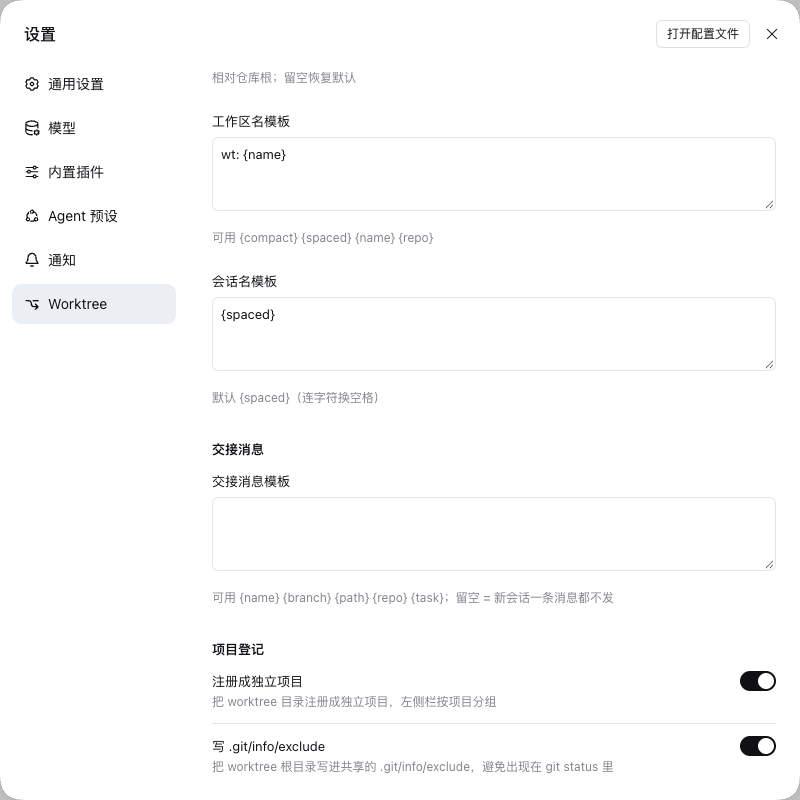

# dsh-worktree

**一个任务一个工作区 —— 在 DSH 里创建 Git worktree、打开新会话，并行任务互不干扰。**



## 安装

需要已安装的 DSH Web 和 Git。在终端运行：

```bash
dsh plugin --profile web add @zhanghanxuan/dsh-worktree
```

安装后重启 DSH，再刷新页面。使用其他 profile 时，将命令中的 `web` 换成对应名称。

## 使用

### 为任务创建工作区

1. 打开一个 Git 仓库的会话，点击侧边栏底部的 **Worktree**。
2. 确认顶部选择的是要操作的仓库。
3. 选择 **已有分支**，或选择 **新建分支**并填写分支名、确认起点；新建分支默认从本地 `main` 创建，也可以手动选择其他起点。
4. 点击 **创建并进入新会话**，直接在新工作区开始会话；只想先建好目录则点击 **只创建**。

工作区默认放在仓库的 `.worktrees/` 下，各自使用独立目录和分支。若本地没有 `main`，请手动选择有效起点。需要更新远端分支列表时，点击右上角的**拉取远端分支**；此操作不会合并当前分支。

### 打开或删除已有工作区

在 **已有 Worktree** 中，点击 **打开新会话**，即可继续在对应工作区处理任务。



不再需要时，点击该工作区的删除按钮：

- 会归档其中的会话、注销工作区登记，并删除工作区目录。
- 默认保留分支；删除本地分支或远端分支需要单独勾选。
- 有未提交改动、工作区被锁定，或尝试删除当前会话所在目录时，会阻止删除。未合并的本地分支不会被自动强删。

**强制删除会丢弃未提交改动，请先确认没有需要保留的内容。**

### 让 AI 帮你操作

也可以直接在对话中提出要求，例如：

> 从 main 创建 feature/login 工作区，并在里面打开一个新会话。

> 列出当前仓库的工作区。

写操作仍受当前会话的权限限制，只读会话不能创建或删除工作区。

### 调整设置

打开 DSH **设置 → Worktree**。文本编辑后移开焦点保存，开关修改后自动保存。



- **路径与命名**：根目录相对仓库根，默认 `.worktrees`；工作区名和会话名可分别设置模板，例如 `{name}` 保留目录名，`{spaced}` 将连字符换成空格。
- **交接消息**：设置新会话收到的消息模板，可使用 `{branch}`、`{path}` 等占位符；默认留空，不自动发送消息。
- **项目登记**：选择是否注册为独立项目、是否将 worktree 根目录写入 `.git/info/exclude`，避免出现在 `git status` 中。

<details>
<summary>查看交接消息与项目登记设置（向下滚动）</summary>



</details>

## 卸载

```bash
dsh plugin --profile web remove @zhanghanxuan/dsh-worktree
```

卸载后重启 DSH 并刷新页面。卸载插件不会自动删除已创建的工作区。
